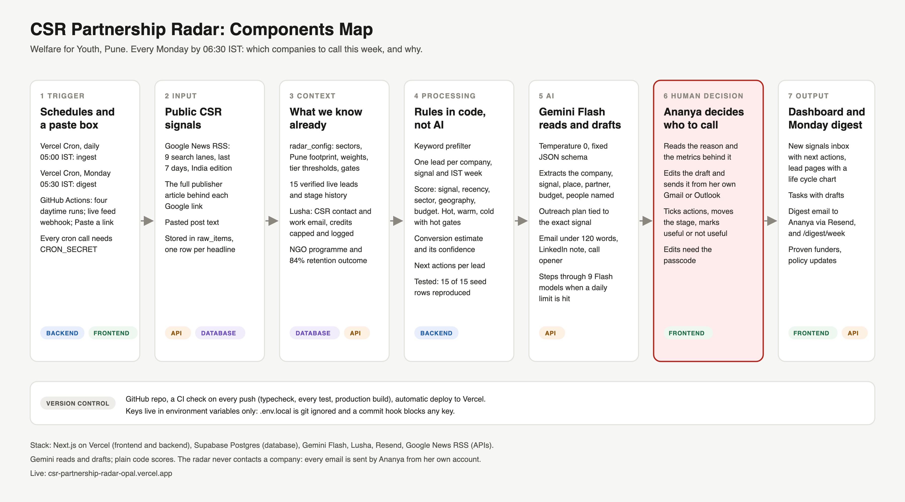

# CSR Partnership Radar

Every Monday by 06:30 IST, Ananya (Head of Corporate Partnerships, Welfare for Youth, Pune) knows which companies to call this week and why.

The radar reads Indian CSR news every morning, scores each signal hot, warm or cold with fixed rules, works out the next actions for each lead, drafts the outreach, and emails a Monday digest. It never contacts a company: Ananya sends every email from her own account.

Live: https://csr-partnership-radar-opal.vercel.app · Components map: [docs/components-map.png](docs/components-map.png) · Plan and decisions: [PLAN.md](PLAN.md)

## Setup (8 steps)

1. **Clone and install.** `git clone https://github.com/yvedant34-lang/csr-partnership-radar && cd csr-partnership-radar && npm install` (Node 22).
2. **Create a Supabase project** and run `seed/schema.sql`, then `seed/seed_live.sql` in the SQL editor. Optional: `seed/seed_synthetic.sql` for the Sample data toggle.
3. **Get the keys:** a Gemini API key (aistudio.google.com/apikey), a Resend API key, and optionally a Lusha API key.
4. **Copy `.env.example` to `.env.local`** and fill in every value. `CRON_SECRET` and `ADMIN_PASSCODE` are any long random strings you choose. `.env.local` is git ignored; never commit it.
5. **Check it:** `npm run check` (typecheck, every test, including all 15 scoring rows, production build).
6. **Run locally:** `npm run dev`, open http://localhost:3000, unlock editing with your `ADMIN_PASSCODE`.
7. **Deploy:** import the GitHub repo in Vercel, add the same environment variables (plus `APP_URL` = your production URL), deploy. `vercel.json` registers the two crons.
8. **First run:** call `GET /api/cron/ingest` with `Authorization: Bearer <CRON_SECRET>` once, then open the dashboard. After that it runs by itself at 05:00 IST daily, and the digest goes out Mondays at 05:30 IST.

## How it works

| Step | What happens | Where |
|---|---|---|
| Ingest | 9 Google News RSS lanes (last 7 days, India), deduped by title | `lib/rss.ts`, `/api/cron/ingest` |
| Read | Each Google link is resolved and the full publisher article is read; headline only as a fallback, marked lower confidence | `lib/article.ts` |
| Extract | Gemini Flash, temperature 0, JSON schema: company, signal, place, partner, budget, people named, an outreach plan | `lib/gemini.ts` |
| Score | Plain code, weights from `radar_config`: signal, recency, sector, geography, budget, partner penalty, hot gates, conversion estimate | `lib/scoring.ts` |
| Act | Next actions per lead in code; hot leads get a Monday call task, an email under 120 words, a LinkedIn note and a call opener; Lusha finds the CSR contact | `lib/next-actions.ts`, `lib/drafts.ts`, `lib/lusha.ts` |
| Decide | Ananya reviews, edits, sends from Gmail or Outlook, moves the stage | lead pages, Tasks |
| Digest | Monday email via Resend, saved and published at `/digest/<week>` | `lib/digest.ts`, `/api/cron/digest` |

**Gemini never sets the score, tier or probability.** The conversion figure is a formula estimate, labelled as one, until 50 won or lost outcomes exist.

**Contacts are never invented.** People come from the article text; Lusha contacts are shown separately with their match type, and an email is revealed only on click (1 credit) or automatically for hot and warm leads, under a monthly cap.

**Gemini limits.** The free tier allows about 20 requests per model per day. The client steps through nine Flash models and remembers exhausted ones in `gemini_model_status` until Google's reset time.

## Notifications and the live feed

Every new signal lands in the **New signals** inbox at the top of the dashboard, with the lead's next actions as checkboxes. Hot and warm signals get the full card; cold ones are listed as watch only. Signals arrive three ways:

- **The morning run** (Vercel Cron, 05:00 IST) and four daytime runs from GitHub Actions (`.github/workflows/radar-schedule.yml`, 09:00, 13:00, 17:00, 21:00 IST; needs the repo secret `CRON_SECRET`).
- **Paste a link** in the app.
- **The live feed:** `POST /api/inbound` with `Authorization: Bearer <INBOUND_SECRET>` and JSON `{"url": "...", "text": "...", "source": "LinkedIn"}`. Point Zapier, Make, IFTTT or a Google Alert at it. LinkedIn is never fetched: LinkedIn posts must arrive as text.

Each lead page also shows its **life cycle** as a step line from Ghosted (lowest) to Invoice signed (highest).

## Environment variables

`GEMINI_API_KEY`, `GEMINI_MODEL` (optional first choice), `NEXT_PUBLIC_SUPABASE_URL`, `NEXT_PUBLIC_SUPABASE_ANON_KEY`, `SUPABASE_SERVICE_ROLE_KEY` (server only), `RESEND_API_KEY`, `DIGEST_TO_EMAIL`, `DIGEST_FROM_EMAIL` (optional, needs a verified Resend domain), `CRON_SECRET`, `ADMIN_PASSCODE`, `LUSHA_API_KEY` (optional), `APP_URL`, `INBOUND_SECRET` (for the live feed).

## Scripts

`npm run check` runs everything CI runs. Under `scripts/`: `build-seed.ts` regenerates the seed SQL from `seed/csr_leads_live.csv`; `dry-run.ts` reads live RSS through Gemini without writing; `run-extract.ts`, `rescore.ts`, `redraft.ts`, `find-contact.ts` run single pipeline steps against the database (`npx tsx --conditions=react-server --env-file=.env.local scripts/<name>.ts`).
